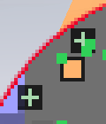

# Aurora Client — Mapping Per-Pixel Rendering Refinement

2026-10-19 · `codex/unified-mapping` · starting commit `6841436`

Aurora's native pixel coverage now supplies mapping borders, masks, symbols and
label plates. Terrain remains cached. Java 21 tests and native scale checks pass.

Aurora's existing RenderUtil coverage rasterizer, RectSink, UiLayerCache,
NativeIconGeometry, MaterialIconRenderer and WorldLineRenderer now provide mapping
chrome and symbols. No competing shader, font backend or terrain renderer was added.
World identity, storage, configuration schema and world-map tile/LOD rendering
remain unchanged.

| Before | After | Why |
| --- | --- | --- |
| Minimap mask/border enlarged with logical-resolution terrain | Cached native-density circle or theme-rounded square, using RenderUtil coverage | One-device-pixel edge coverage at GUI and fractional HUD scales |
| Block-built markers, entity squares and player tail | Shared AA silhouettes, circular dots and outlined directional arrow | Clearer marker hierarchy and precise placement |
| Rectangular HUD label plates and stepped off-screen indicator | Theme-rounded cached plates, style previews, native FreeType chevron | Consistent corners, strokes and icon clarity |
| Crowded minimap distances | Existing label layout excludes compass and other distances | Readable labels without changing navigation data |
| Map names crossed neighboring icons | Reserve icons, player and chrome, then try four label positions | Dense groups retain visible symbols and readable names |
| Thin world-space cuboid edges | Existing GPU-expanded, two-device-pixel world lines | Stable outlines at distance and accurate camera-relative coordinates |

Manager/editor retain their shared per-pixel controls, color swatches, typography
and materials. They add marker previews; editor color previews are transactional.
Text uses Aurora's configured font backend, with device-aligned baselines instead
of a separate text rasterizer. The shared span rasterizer also now includes an
exact-integer left edge that was previously omitted.
Disconnect cleanup now runs on the client executor. Native log review exposed
texture deletion from a Netty callback in the reference and intermediate versions;
the runner now rejects this warning instead of accepting only functional assertions.

Terrain sampling stays at the configured logical size and remains dirty-driven,
at most 20 Hz. Bulk copies expand cached rows before native masking; opaque mask
interiors need no work. Unchanged stationary terrain does not upload. The minimap
output is capped at 2048² pixels; very large, mostly off-screen HUD configurations
can therefore resample. Resize refreshes are capped at 20 Hz, then settle at native
density. Resized textures survive the frame that referenced them. Marker/plate
layers use a primitive-key cache capped at 128 entries / 4M texels (16 MiB per
CPU/GPU pixel copy). Unchanged arrow
orientations are cached separately for minimap and map; changing directions retain
continuous AA. Three-dimensional beam/fill meshes remain GPU geometry.

Native screenshots and measured results are recorded under
`docs/mapping/pixel-refinement/`. Cropped edge comparisons retain original pixels;
no resampling or generated imagery is used as evidence.

## Validation

Java 21 `test build`: **575 tests, zero failures/errors/skips**, production jar built.
Native rendering: **15/15 checks**, normal exit; all six requested framebuffer sizes
were observed, with 24 screenshots covering the four mapping surfaces.
Native functional workflow: **22/22 checks**, normal exit, including live color
preview/Cancel/Save, editor propagation, 10,001 records with bounded draw/control
counts, archive, dimension transitions, toggle/reset, reload and reconnect.
Both final native snapshots match current build classes/resources byte for byte.
Both runs have zero render-thread/texture-close warnings, including disconnect
and reconnect. The ordinary production jar contains no diagnostic probe classes.
Native rendering checks cover 1920×1080 (GUI 2/3), 2560×1440 (GUI 3/4),
3840×2160 (GUI 4/6), circular/square minimaps, HUD scales 1/1.25, map, manager,
editor, HUD editor, resource reload and stationary repaint suppression.
Native backend: AMD Radeon RX 9070 XT, OpenGL 3.3 core, Sodium 0.8.14.

Native crops below preserve original pixels. Layout contact sheets are downsampled
overviews, explicitly separate from the native edge evidence.

| Reference / final | Native pixels |
| --- | --- |
| Circular edge before |  |
| Circular edge after |  |

[Minimap scales](docs/mapping/pixel-refinement/final-hud-scales.png) ·
[Map scales](docs/mapping/pixel-refinement/final-map-scales.png) ·
[Manager scales](docs/mapping/pixel-refinement/final-manager-scales.png) ·
[Editor scales](docs/mapping/pixel-refinement/final-editor-scales.png).
Native close-ups show the [square corner](docs/mapping/pixel-refinement/final-square-edge-4k.png),
[map icons and labels](docs/mapping/pixel-refinement/final-map-markers-4k.png), and
[editor typography](docs/mapping/pixel-refinement/final-editor-detail-4k.png), plus
the [in-world marker](docs/mapping/pixel-refinement/final-world-marker-4k.png).

## Performance

The sequential gameplay reference/refined pair used identical input manifests and
observer binaries: 1280×720, GUI 2, Java 21, G1/2048 MiB, PARK/500, automatic
Reflex and Sodium. Setup plus 30 seconds of warmup preceded three 60-second
phases. Focus was valid in every measured frame. No other client, server or build
ran during measurement.

| Phase | P95 ms reference → final | P99 ms reference → final | CPU % of one core reference → final |
| --- | --- | --- | --- |
| Stationary minimap | 8.389 → 8.372 | 9.120 → 9.281 | 108.22 → 103.58 |
| Traversal | 8.385 → 8.344 | 8.928 → 8.964 | 192.52 → 185.20 |
| Alternating settings/gameplay | 33.334 → 33.334 | 33.346 → 33.390 | 38.94 → 37.75 |

The final capture had no intervals over 50 ms in any phase; the reference had
one in traversal and one in the UI phase. Largest phase RSS difference was
+12.34 MiB (about 0.53%). Whole-recording JFR allocation weights were
268.43 → 268.54 MiB/s; maximum GC pause was 28.17 → 26.59 ms. Weights include
startup/setup/save and are statistical, not exact phase allocations. Primitive
region-key allocation weight remained zero.
Candidate-04 contains the final rendering and label implementation. The subsequent
change only schedules disconnect cleanup on the client executor, outside all
measured phases. Candidate-03 retains the earlier cached-arrow gameplay repeat.

One capped pair does not establish an FPS/CPU improvement. The small mixed tail
changes do not show a material regression in this tested workload. A separate
4K continuous-turning check measures the higher-density presentation. The first
uncached AA-arrow variant added avoidable CPU work and was refined before final
acceptance. Broader GPUs, uncapped workloads and extended soak are not established
by these bounded captures. No pacing, Reflex, JVM or Launcher policy changed.

The final 3840×2160 / GUI 6 / HUD 1.25 continuous-rotation check recorded
120.00 FPS, P95 8.398 ms, P99 8.676 ms, no intervals over 50 ms and zero invalid
focus frames. Reference: 119.89 FPS, P95 8.366 ms, P99 8.541 ms. Final sampled
RSS was +13.64 MiB. Cached-arrow repeats used 66.26–73.49% of one core versus
71.08% in the reference; the largest observed increase was approximately
**0.20 ms aggregate CPU per frame**, with +24.68 MiB sampled RSS. The uncached
prototype used 82.34% of one core and was refined. This variation does not isolate
a stable CPU gain or regression. All runs use the same 2–14 second stage interval
and linearly interpolated CPU endpoints after native QPC calibration, correcting
the inconsistent endpoint selection in earlier progress estimates. Native output
requires additional bounded memory/copy work; no zero-overhead claim is made.
Simulation is frozen in this graphics comparison; the gameplay capture exercises
active simulation and traversal. Broader/uncapped performance remains unverified.

## Repository

Renderer integration: `51cd675`; label/cache refinement: `041cd48`;
GPU lifetime fix: `f08cf92`. Evidence accompanies this report. All work is local.
Original `run/` data and pre-existing
benchmark notes are preserved. No push, merge, publication or instance installation.

Reproduce summaries and image crops from preserved disposable fixtures with
`tools/mapping_pixel_evidence.py reference candidate functional output`.
JSON files record checks, observer/runtime hashes, screenshot source hashes and
exact native crop rectangles. Raw saves, launch specifications, JFR and full
captures remain in the marked private Temp fixtures. Initial rendering attempts
reference-01 (terrain did not settle), reference-02 (unrelated overlays), and
candidate-03 (stale build after compile error) are excluded; clean reference-03 and
final candidate-09 provide the screenshot comparison. Candidate-06 retains the
uncached prototype timing; candidate-07/08 retain cached-arrow repeats before the
disconnect cleanup correction. Their known cleanup warnings are retained in the
JSON log checks; the final rendering and functional runs require zero warnings.
