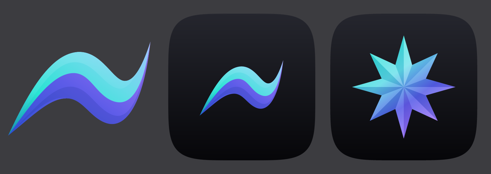
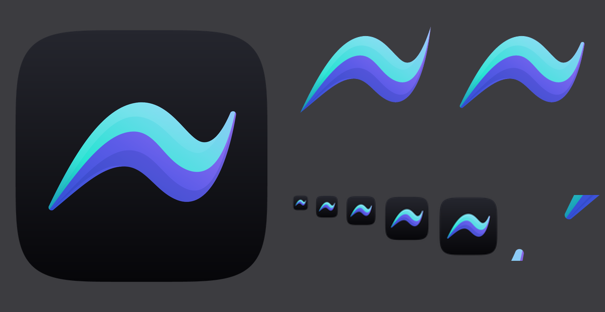

# Aurora mark and app icon rework — 2026-11-19

Owner request: a larger mark and app icon, rounder at the points so small sizes
keep their shape, with gem-like shading similar to Nova Studio's icon.

## What changed

The mark is the owner's 2026-11-02 ribbon, unchanged (curves, bands, gradients,
fold and edge light), except for its two needle points. Earlier faceted and
reshaped versions were rejected on 2026-11-19.

- **Tips.** Each point is cut where the ribbon is 18 units wide (measured on the
  real curves) and closed with a half circle, so both ends survive small sizes.
  The half circle lies inside the original shape and takes the original colours.
- **Size.** The ribbon fills 78% of the app-icon tile's width (it filled about 60%).
- **Source.** `tools/gen_aurora_brand.py` writes `branding/aurora.svg` (original
  640x512 viewport), `branding/aurora-icon.svg` (the dark Spxctra tile with the
  mark), the 1024 px `icon.png` and, through `tools/prepare_brand.py`,
  `textures/ui/aurora_mark.png`. `prepare_brand.py` now writes to the shared
  adapter, where the brand assets live.

| Before | After |
| --- | --- |
|  |  |

[Title screen, 26.3, 1600x900](title-after.png).

The Aurora Launcher and website carry their own copies of the previous mark and
icon (the 2026-11-02 files were identical to the launcher's); they are unchanged here.
