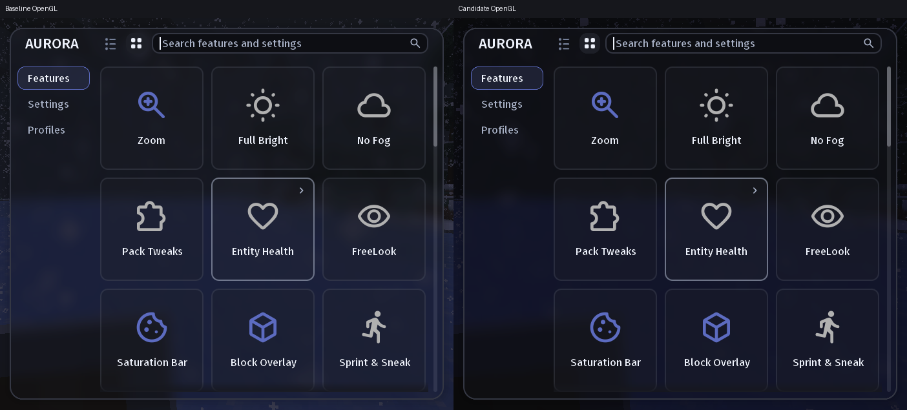
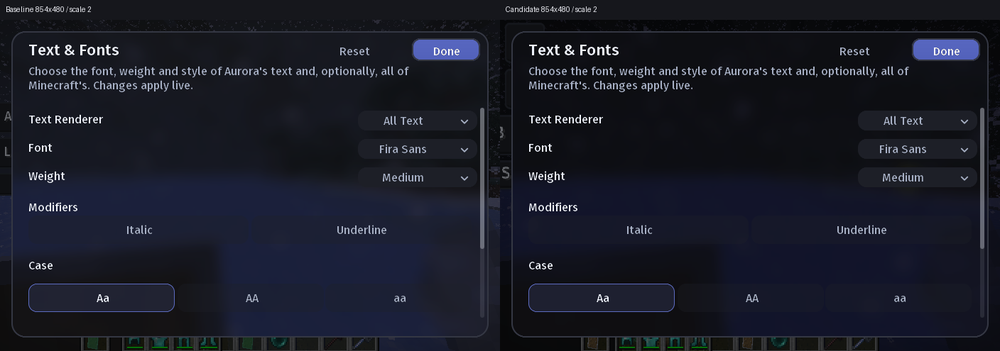
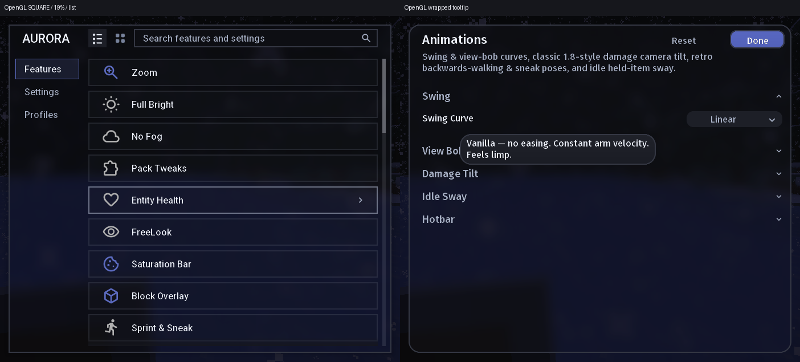
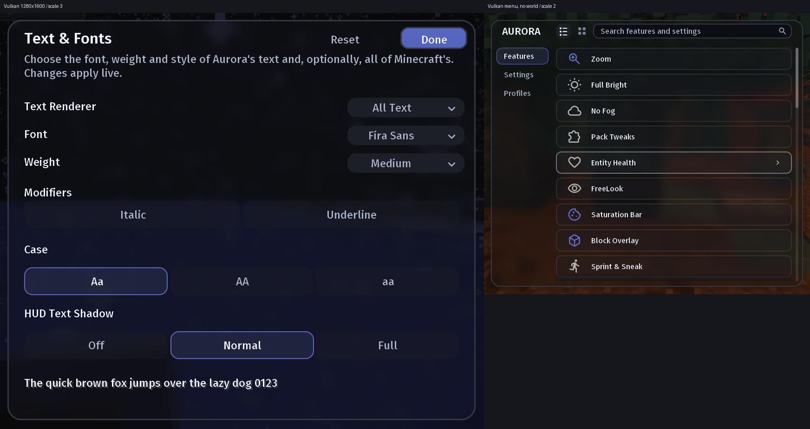

# Bounded UI caches and open-screen measurements

2026-11-17. Baseline: `39a71cf4110ea1e1e22f611df0090facae81cff1`.
Candidate: the production changes accompanying this report on
`ui/bounded-layer-caches`. The four production files were restored to the exact
baseline for its boot, then the candidate was reapplied before both candidate
boots. No runtime behavior was changed between the candidate boots.

## Purpose and implementation

Keep browsing and editing Aurora settings visually stable while reducing
unnecessary static-layer work. This is the first backend refinement from the
[ModernUI-MC investigation](https://github.com/BloCamLimb/ModernUI-MC), using
its resolve/cache/invalidate discipline as a reference. No upstream code or
dependency was imported; Aurora retains its native renderer and MIT code.

- `UiLayerCache.ensureRegion` captures a physical-pixel rectangle, translating
  existing draw coordinates before clipping and source-over blending. Moving
  or resizing the capture invalidates it; moving without resizing reuses its
  backing image. Local row-template captures still use `ensureSize`.
- The main screen captures its window plus eight GUI pixels of glow/AA margin.
  Detail chrome has nine pixels of margin; detail row shapes capture exactly
  the body scissor. Blits use corresponding logical bounds. The 336×288 window
  contract and small-viewport margins are unchanged.
- Unified chrome has identical cached pixels whether glass is available or
  suppressed. Its key no longer includes that state. Legacy chrome keeps the
  dependency; detail row pixels have no glass dependency. Row keys retain
  theme, raster scale, shape fingerprint, content height and integer scroll.
- Main/detail close paths queue texture retirement until the next extraction
  frame, preserving deferred draws. Main previously omitted its cache cleanup;
  detail previously disposed immediately.
- Setting tooltips retain one prepared wrap/width result while visible or
  fading. Content, font identity, Language identity, theme generation and text
  style invalidate it. Vanilla replaces Language on successful resource reloads,
  covering font-pack changes even with the same literal text and locale. The
  prepared layout drops after full fade-out. Dwell (1500 ms), fade (200 ms),
  positioning, input and drawing are unchanged.

No controls, effects, layout hierarchy, feature defaults or settings were added.
Waypoint deletion remains one click. This does not implement a general layout
engine, widget recycling, a new text renderer or a texture-memory budget.

## Method and limits

The opt-in `tools/parity` probe observes extraction HEAD/RETURN, cache allocation
boundaries and commits. It is excluded from production sources/JARs. Each sample
contains 120 warm-up and 600 steady frames, with first extraction reported
separately. Payload equals the committed image dimensions × four bytes; totals
include material templates. Tracked backing bytes estimate observed CPU images,
including screens not yet retired or collected; they are not VRAM measurements.

Windows 11, Radeon RX 9070 XT, Java 25.0.4.1, Minecraft 26.3; the same copied
singleplayer world and disposable configuration were reused. Paired measurements
use ROUND/33%, Fira Sans Medium / All Text, native Unlimited, VSync off. Aurora's
GUI cap is configured to 60 but native Unlimited currently takes precedence;
the roughly 0.6–0.7 ms OpenGL intervals confirm these samples were uncapped.
The probe's `factory` command uses field initializers, without overlaying the
shipped defaults JSON: these are factory-appearance comparisons, not release
overhead acceptance with effective factory configuration.

These are short sequential samples on one machine, without a statistical
confidence estimate. Elapsed extraction includes possible scheduling stalls and
excludes deferred GUI draws and GPU work. First extraction includes font/icon
first-use work. Neither lower payload nor one lower timing proves an FPS gain.
Actual screenshot files show different world/blur content as time passes; they
validate geometry and clipping, not whole-screen pixel equality.

## Payload results

Raw samples and scope metadata: [measurements.json](evidence/ui-cache-refinement/measurements.json).
MiB below means 1,048,576 bytes.

| Case | Baseline | Candidate | Interpretation |
|---|---:|---:|---|
| Main fresh reopen, 1280×960 / scale 2 | 5,168,512 B | 1,965,440 B | Five commits each; 62.0% less total payload |
| Animations detail fresh open, same size | 9,919,552 B | 2,958,976 B | Five commits each; 70.2% less total payload |
| One main screenshot-suppression cycle, same size | 9,830,400 B, two commits | 0 B, zero commits | Both unnecessary chrome rebuilds removed |
| Text & Fonts scrolling row, 854×480 / scale 2 | 1,639,680 B per commit | 757,760 B per commit | 53.8% less per rebuild |
| Text & Fonts fresh open, 1280×1600 / scale 3 | 16,906,864 B | 6,979,968 B | Eight commits each; 58.7% less total payload |

For the small scrolling sample, baseline had 326 commits / 509.77 MiB and
candidate had 333 / 240.64 MiB. Scroll smoothing depends on elapsed time, so the
commit counts differ; per-rebuild payload is the controlled comparison. This
page actually overflows at this viewport. Larger Text & Fonts pages fit, and
their wheel samples were excluded from scrolling evidence.

The main chrome image itself changes from 1280×960 to 704×608 at scale 2:
4,915,200 to 1,712,128 CPU backing bytes and upload bytes. At scale 3 in a
1280×1600 framebuffer it becomes 1056×912: 8,192,000 to 3,852,288 bytes.
Image sizes are bounded by window geometry and GUI scale rather than the
whole framebuffer. GPU allocation overhead and allocator behavior were not
measured.

## Timing observations

| OpenGL paired sample | Baseline steady mean / p95 | Candidate steady mean / p95 |
|---|---:|---:|
| Main reopen | 0.0469 / 0.0574 ms | 0.0546 / 0.0679 ms |
| Animations detail | 0.0570 / 0.0989 ms | 0.0603 / 0.0971 ms |
| Small Text & Fonts scrolling | 0.1148 / 0.2077 ms | 0.1066 / 0.1718 ms |
| Large Text & Fonts | 0.0467 / 0.0565 ms | 0.0496 / 0.0590 ms |

Steady results are mixed. These samples support a payload reduction, not a
general CPU/frame-rate improvement. First extraction of Animations fell from
44.87 to 13.76 ms, but includes unrelated warm-up and is not an isolated cache
speed measurement. The separate candidate-only SQUARE/19%, Roboto / Aurora Only
sample with native FPS option 120 produced 16.667 ms mean intervals, confirming
operation with Aurora's 60 FPS GUI pacing. It has no paired baseline.

Native Vulkan was a candidate correctness smoke test, not a baseline comparison.
Its main-screen steady mean/p95 was 0.0977/0.1694 ms in this run. Backend selection
was confirmed by the launch log (`Using graphics backend Vulkan`), independently
of the probe's metadata label. All 92 Aurora mixins applied on both backends.

## Verification

- `python tools/parity.py`: tests and production builds passed on 26.1.2, 26.2
  and 26.3. JUnit reports: 1194, 1194 and 1196 tests respectively, zero failures
  or errors; one opt-in stress test skipped per line.
- [Verification record](evidence/ui-cache-refinement/verification.json) retains
  test counts and backend, mixin-health and tooltip assertion log excerpts.
- The optional `parityProbeJar` compiled against all three native classpaths.
- `UiLayerRegionTest` compares full vs cropped raster pixels at GUI scales 1–4,
  including every crop edge, fractional AA, translucent overlap, rounded
  outlines and circles. It also verifies storage reuse when moving and local
  coordinates after switching back to `ensureSize`.
- Actual 26.3 OpenGL and native Vulkan boots: main grid/list, ROUND/33% and live
  SQUARE/19%, detail screens, small scrolling at 854×480 / scale 2, large detail
  at 1280×1600 / scale 3, resize/reposition, close/reopen and menu with no world.
  Inspected full screenshots for cut-off glows, clipped rows and text overflow.
  Search focus/caret remained visible. No new decorative treatment to subtract.
- OpenGL tooltip: wrapped text after dwell, same layout object across unchanged
  frames, invalidation after Roboto font-policy change and resource reload,
  release after fade-out. An initial reload assertion ran just as its overlay
  cleared, before the screen rendered; repeating after completion and re-hover
  passed. Tooltip checks use the native screen/renderer, not a mocked font.
- Screenshots below are native-size crops, combined with captions; no panel
  scaling or visual edits. Native handlers were driven by the disposable probe;
  this was not a full physical-input or screen-reader audit. Older adapters were
  compiled/tested, not booted in this task. The fourteen-row release matrix and
  gameplay overhead gate remain release requirements, not claims of this audit.

## Follow-up

Measure the repeated settings-measurement walks before adding dirty-layout
caching. A live cache-byte diagnostic/budget and global tooltip-state hygiene
are separate opportunities. Background FPS/audio behavior, borderless window
modes and smooth vanilla lists remain separate user-facing candidates; none is
required for these backend changes. ModernUI is a reference, not a dependency.
