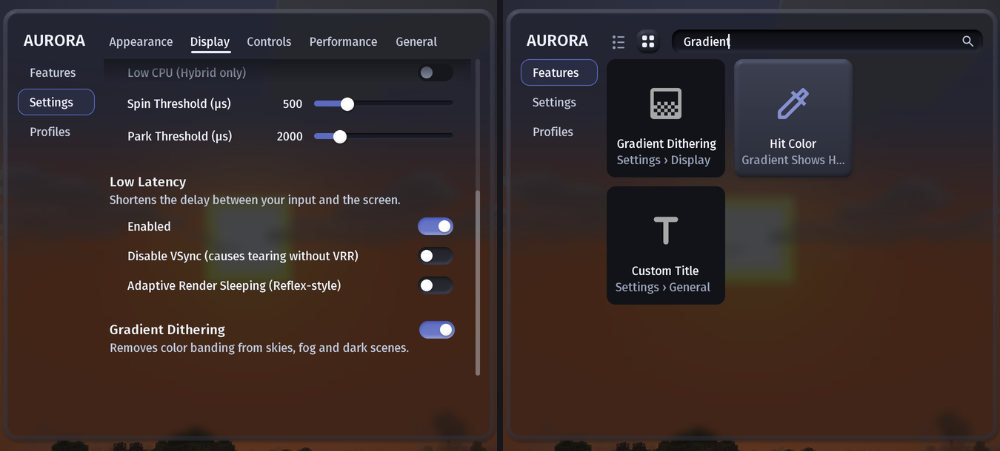

# Gradient Dithering (2026-11-20)

Sky, sunset glow, fog, clouds and terrain lighting are shaded in floating point and stored in an 8-bit colour target (`RGBA8_UNORM`), turning slow ramps into visible colour bands. Gradient Dithering adds a fixed 8×8 ordered Bayer offset of strictly less than ±0.5 LSB per channel to world shaders before quantisation, removing the bands while preserving every pixel's average colour and leaving exact 8-bit steps untouched.

## Design and seam

- **Shader-source + twin-pipeline seam.** `GradientDitherSourceMixin` (`ShaderManager.loadShader`) appends the dither epilogue to eligible world fragment shaders (`sky.fsh`, `position_color.fsh`, `position_tex_color.fsh`, `terrain.fsh`, `clouds.fsh` / `rendertype_clouds.fsh`, and Sodium's `block_layer_opaque.fsh`) behind `#ifdef AURORA_GRADIENT_DITHER`. Without the define, the patched source compiles identically to vanilla, so GUI and HUD pipelines that share `position_color.fsh` or `position_tex_color.fsh` are never dithered.
- **Pipeline selection.** `GradientDitherPipelineMixin` swaps eligible world pipelines (`pipeline/sky`, `pipeline/sunrise_sunset`, `pipeline/end_sky`, terrain and multidraw terrain, clouds, and Sodium's `sodium:blocks/block_layer_opaque`) to a cached `Dithered` twin carrying `AURORA_GRADIENT_DITHER` (`1` for opaque passes, `2` for straight-alpha passes). On 26.1.2 and 26.2 this hooks `RenderPass.setPipeline`; on 26.3 it hooks `RenderSystem.getCompiledPipelineNullable` (covering both OpenGL and native Vulkan via RenderPearl). Order-independent transparency passes (`OIT_*`), non-`RGBA8_UNORM` targets, non-standard blends, and all GUI/HUD pipelines return the original pipeline unchanged.
- **Ordered 8×8 Bayer offset without LUT copies.** The epilogue computes the 0..63 Bayer rank from `ivec2(gl_FragCoord.xy) & 7` using bit arithmetic (`offset = (float(rank) + 0.5) / 64.0 - 0.5`, strictly inside `(-0.5, +0.5)` LSB). Opaque passes explicitly round with `floor(fragColor.rgb * 255.0 + offset + 0.5) / 255.0` so driver-specific float-to-UNORM conversion (measured on RX 9070 XT, where AMD's export path truncates through half float and shifts rounding by up to 0.125 step) cannot introduce dark-band bias. Straight-alpha passes transpose the 8×8 cell (`cell.yx`), scale the offset by `1 / alpha` clamped to `clamp(min(rgb, 1 - rgb), 0, 1) * 510` so the source never clips, and never dither alpha.
- **Stand-downs and fail-soft safety.**
  - **VulkanMod (26.1.2):** both mixins declare `.yieldsTo("vulkanmod")` in `FeatureCatalog` and skip cleanly at startup.
  - **Iris:** `ShaderPackState.irisPackInUse()` binds `IrisApi.getInstance().isShaderPackInUse()` by reflection. With a shader pack active, `GradientDitherPipelines.select()` returns the original pipeline and logs the stand-down; with Iris installed and no shader pack active, dithering runs normally.
  - **Resource packs & compile failures:** fragment sources without a single `main()` writing `out vec4 fragColor;` are left untouched; any twin that fails to compile falls back to the original pipeline until the next shader reload. Both mixins are gated by `gradientDither` in matching order across all three `aurora.mixins.json` files (ADR 0004).

## Default, Fair Play and UI

- **Default: on (`gradientDither = true`).** Per ADR 0007, Gradient Dithering is classified as **Cosmetic** (`docs/FAIR_PLAY.md`): offsets stay strictly within ±0.5 LSB, 8×8 cell averages match the exact shaded colour, exact 8-bit values are unchanged, and nothing becomes easier to see. Unlike an advantage feature (ADR 0007) or a visual-trade-off optimization (ADR 0009), removing 8-bit banding is a pure visual quality improvement with negligible cost (~0.016 ms/frame), so it ships enabled in fresh installs while remaining profile-scoped and toggleable on **Settings → Display**.
- **UI & overflow review.** Registered on Settings → Display (`Gradient Dithering`, summary *"Removes color banding from skies, fog and dark scenes."*) with the Material Symbols `gradient` (`\uE3E9`) icon in `FeatureIcons`. Verified at GUI scales 1, 2 and 4 in Settings → Display and in both Grid and List search views (`Gradient`): no text overflow, clipping or misalignment.

## Automated tests

- `GradientDitherTest` (all 3 lines): verifies single-patching and idempotency on every real vanilla world fragment shader (`sky.fsh`, `position_color.fsh`, `position_tex_color.fsh`, `terrain.fsh`, `clouds.fsh` / `rendertype_clouds.fsh`), exact bit-arithmetic match to the recursive 8×8 Bayer matrix, strict ±0.5 LSB bounds, exclusion of GUI/OIT/non-RGBA8 pipelines, Iris stand-down and fail-soft bindings.
- `GradientDitherShaderGpuTest` (all 3 lines, real OpenGL 3.3 context on RX 9070 XT via per-adapter `HiddenGlContext`): compiles and executes each line's real vanilla `sky.fsh` and `position_color.fsh` in all three variants (unpatched, patched without define, patched with define):
  - Without the define, patched shaders output byte-identical pixels to vanilla.
  - Exact 8-bit steps (`0, 1, 37, 128, 254, 255`) are pixel-for-pixel unchanged.
  - Alpha is never modified.
  - On all three lines (26.1.2, 26.2, 26.3):
    - `sky`: band edges `14 -> 0`, worst 8-px block error `0.406 -> 0.031` steps, mean error `-0.0195 -> 0.0078` steps.
    - `sunrise fan` (straight alpha): band edges `13 -> 0`, worst 8-px block error `0.416 -> 0.045` steps, mean error `-0.0023 -> -0.0082` steps.
- `python tools/parity.py` passed test and build across 26.1.2, 26.2 and 26.3; `python -B -m unittest discover -s tools -p 'test_*.py'` passed all 43 tests.

## Visual verification matrix

All boots ran in disposable fixtures on the portrait second monitor (`1422×2453` client area, Windows 11, AMD Radeon RX 9070 XT, Java 25). Modded fixtures copied the owner's launcher instance mods omitting Spark, Simple Voice Chat, Crash Assistant, Fabric API (provided by Loom) and Aurora's installed jar. On 26.3 native Vulkan, Iris was omitted because Iris 1.11.7 aborts under `--graphicsBackend VULKAN` independently of Aurora (`docs/MOD_MATRIX.md`).

| Line & Backend | Mods | Pipelines dithered | Mixin health | Result |
|---|---|---|---|---|
| 26.1.2 OpenGL | None (0 mods) | 5 shaders patched, 8 vanilla world pipelines | All applied | Pass — all 6 scenes + GUI/HUD |
| 26.2 OpenGL | Owner's 26.2 set (25 mods: Sodium, ImmediatelyFast, MoreCulling, EMF/ETF, etc.) | 6 shaders patched, 8 vanilla + 3 Sodium terrain | All 111 applied/stood down (7 stood down) | Pass — all 6 scenes + GUI/HUD |
| 26.3 OpenGL | Owner's 26.3 set (33 mods, incl. Iris 1.11.7 with no pack, Sodium, Sodium Extra, C2ME, Lithium, ModernFix, ImmediatelyFast) | 6 shaders patched, 11 vanilla + 3 Sodium terrain | All 112 applied/stood down (9 stood down) | Pass — all 6 scenes + GUI/HUD + ABBA bench |
| 26.3 Native Vulkan | Owner's 26.3 set minus Iris (32 mods) | 6 shaders patched, 11 vanilla + 3 Sodium terrain | All 112 applied/stood down (9 stood down) | Pass — all 6 scenes + GUI/HUD |
| 26.3 OpenGL + Iris pack | Owner's 26.3 set + `ComplementaryReimagined_r5.9.3.zip` active | Stood down at draw time (`standing down while an Iris shader pack draws the world`) | All 112 applied/stood down | Pass — shader pack rendered cleanly, zero errors |

### Measured banding metrics

Each crop is partitioned into 8×8 blocks (one full Bayer cell). **Band edges** count adjacent blocks along the gradient axis whose means jump by ≥ 0.5 step while the 7-block moving average changes by < 0.25 step (isolated star/particle outliers excluded). **Contour RMS** is the RMS deviation of block means from that smooth trend, in 8-bit steps.

| Scene (crop `x,y,w,h`) | Config | Band edges R/G/B (off → on) | Contour RMS R/G/B (off → on) | Mean shift R/G/B (steps) |
|---|---|---|---|---|
| Sunset upper sky (`40,80,640,360`, cloud-free) | 26.3 OpenGL | 295/4/223 → 3/3/3 | 0.186/0.023/0.163 → 0.025/0.023/0.026 | +0.050 / +0.271* / +0.033 |
| Sunset upper sky (`40,80,640,360`, cloud-free) | 26.3 Vulkan | 295/4/223 → 3/3/3 | 0.186/0.023/0.163 → 0.025/0.023/0.026 | +0.050 / +0.271* / +0.033 |
| Sunset upper sky (`40,80,640,360`, cloud-free) | 26.2 OpenGL | 280/3/218 → 3/3/3 | 0.184/0.023/0.159 → 0.026/0.023/0.026 | +0.017 / +0.040 / +0.027 |
| Sunset upper sky (`40,80,640,360`, cloud-free) | 26.1.2 OpenGL | 279/25/220 → 3/3/3 | 0.183/0.045/0.161 → 0.025/0.023/0.026 | +0.038 / +0.318* / +0.027 |
| Night sky (`40,40,1344,1520`) | 26.3 OpenGL / Vulkan | 196/268/381 → 25/25/25 | 0.054/0.059/0.072 → 0.024/0.024/0.025 | +0.030 / +0.072 / −0.020 |
| Foggy horizon (`8,880,624,280`) | 26.3 OpenGL / Vulkan | 67/173/0 → 0/0/0 | 0.181/0.190/0.000 → 0.129/0.067/0.000 | +0.054 / +0.043 / 0.000 |
| Underwater fog floor (`200,1300,960,720`) | 26.3 OpenGL | 1700/47/1488 → 31/31/22 | 0.234/0.049/0.228 → 0.054/0.055/0.063 | −0.036 / +0.020 / +0.042 |
| Underwater fog floor (`200,1300,960,720`) | 26.3 Vulkan | 1676/35/1485 → 22/25/23 | 0.232/0.042/0.232 → 0.054/0.055/0.060 | −0.047 / +0.008 / +0.027 |
| Nether fog floor (`200,1300,960,720`) | 26.3 OpenGL | 932/1030/783 → 67/27/5 | 0.175/0.172/0.163 → 0.119/0.096/0.080 | +0.048 / +0.019 / +0.018 |
| Nether fog floor (`200,1300,960,720`) | 26.1.2 OpenGL | 912/857/752 → 49/20/2 | 0.177/0.158/0.151 → 0.117/0.094/0.078 | +0.046 / +0.023 / +0.023 |
| End sky (`40,40,800,1000`) | All 4 configs | 0/0/0 → 0/0/0 | 0.000/0.000/0.000 → 0.000/0.000/0.000 | 0.000 / 0.000 / 0.000 |

*\*On 26.1.2 and 26.3 sunset sky, the green channel sits on a single flat quantised step (`108.006` off) while the true shaded value is `~108.27`; dithering restores the fractional average that 8-bit rounding had truncated. Remaining edge counts in sunset (3) and night (25) correspond to star quads.*

- **GUI and HUD untouched.** Across all four active configurations, opaque HUD elements (`keystrokes_W_text` 432/432 px, `crosshair_area` 484/484 px) were 100% pixel-identical between `gradientDither=false` and `gradientDither=true`.

### Visual evidence crops

Each sheet shows **off** (left) vs **on** (right): native 1× pixels on top, shared contrast-stretched view on the bottom so single-step 8-bit contours are clearly visible.

- Sunset sky, 26.3 OpenGL: [sunset-26.3-opengl.png](evidence/gradient-dither/sunset-26.3-opengl.png)
- Sunset sky, 26.3 native Vulkan: [sunset-26.3-vulkan.png](evidence/gradient-dither/sunset-26.3-vulkan.png)
- Horizon fog, 26.3 OpenGL: [fog-26.3-opengl.png](evidence/gradient-dither/fog-26.3-opengl.png)
- Underwater fog ramp (Sodium terrain), 26.3 native Vulkan: [underwater-26.3-vulkan.png](evidence/gradient-dither/underwater-26.3-vulkan.png)
- Nether fog ramp (Sodium terrain), 26.3 OpenGL: [nether-26.3-opengl.png](evidence/gradient-dither/nether-26.3-opengl.png)
- Settings → Display & Search card, 26.3 OpenGL: [ui-settings-search.png](evidence/gradient-dither/ui-settings-search.png)

## Frame-time cost (in-boot ABBA)

Measured in one 26.3 OpenGL session (owner's 33 mods, `1422×2453`, spectator noon overworld looking across terrain/sky, uncapped, 16,384 frames per run after 2 s warm-up, toggled in memory via parity probe `config gradientDither`):

| Run | State | Avg FPS | Median frame (ms) | p95 frame (ms) | Aurora CPU mean (ms) | Aurora CPU p95 (ms) | Fills / Glass |
|---|---|---|---|---|---|---|---|
| `bench-on-1` | On | 2,254.6 | 0.3906 | 0.7482 | 0.0329 | 0.0441 | 0.0 / 0.0 |
| `bench-off-1` | Off | 2,328.2 | 0.3729 | 0.7850 | 0.0317 | 0.0384 | 0.0 / 0.0 |
| `bench-off-2` | Off | 2,311.2 | 0.3748 | 0.7975 | 0.0329 | 0.0391 | 0.0 / 0.0 |
| `bench-on-2` | On | 2,233.4 | 0.3898 | 0.8136 | 0.0333 | 0.0532 | 0.0 / 0.0 |

- **ABBA delta:** `+0.0163 ms` median frame time (`0.3902 ms` on vs `0.3739 ms` off) — ~16 µs at 1422×2453 (~0.4% of a 240 Hz frame, ~0.1% of a 60 Hz frame). Both `on` runs and both `off` runs agreed within 2 µs.
- **Overhead budget (ADR 0005):** Aurora CPU `0.033 ms` mean / `0.044–0.053 ms` p95 (well below `0.25 ms` mean / `0.40 ms` p95), `0.0` fills and `0.0` glass per frame.
- *Contention note:* the driver waited 165 s for other parallel `KnotClient` processes to exit before starting the boot; one unrelated `KnotClient` (PID 3768) started before teardown, though the tight ABBA symmetry (`0.3906 / 0.3729 / 0.3748 / 0.3898 ms`) indicates negligible interference during the timed window.
