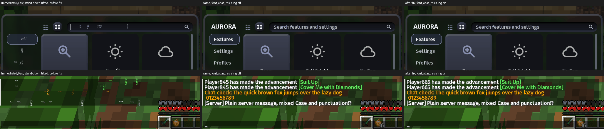
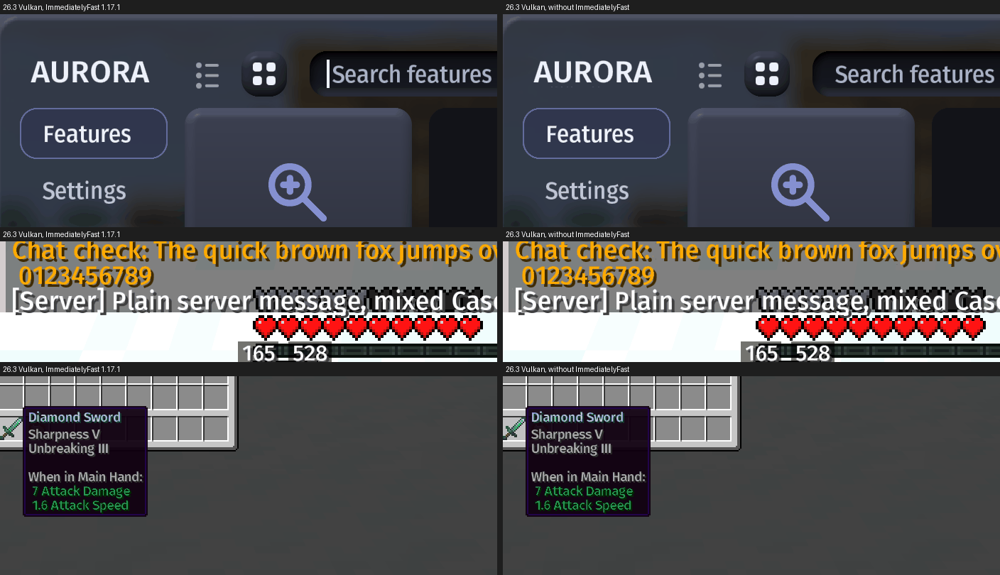
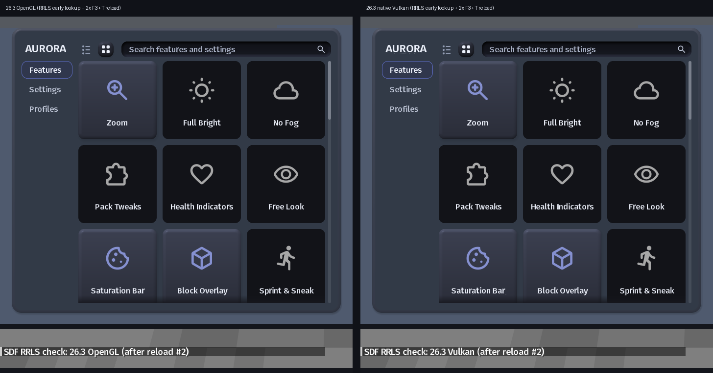

# SDF text with ImmediatelyFast (2026-11-20)

3.6.0 stood SDF text down for ImmediatelyFast, because SDF text came out garbled alongside it ([ADR 0010](../adr/0010-opt-in-sdf-text-with-vanilla-layout.md)). Both of the owner's instances run ImmediatelyFast, so they got the bitmap fallback. This pass found the cause, fixed it and removed the stand-down. It also removed a second stand-down, deferred font preparation for ModernFix, which turned out to be a false positive.

## Root cause

ImmediatelyFast's `font_atlas_resizing` option (`MixinFontTexture`, on by default, `font_atlas_size` 1024) applies `@ModifyConstant(method = "*")` to every `256` and `256.0F` in vanilla's `FontTexture`. That covers the texture size, the packing tree and the texture coordinates of vanilla glyphs. The same code is in 1.16.5 (26.2) and 1.17.1 (26.3). Each page records the flag when it is constructed.

Aurora's SDF pages are vanilla `FontTexture`s (`NativeSdfText.createPage`), so they also became 1024 × 1024, and glyphs were packed anywhere up to 1024. `SdfInstance` still divided cell positions by `SdfAtlas.SIZE` (256). Every SDF quad therefore sampled a region four times too far out, clamped at 1: mostly empty texels plus fragments of other glyphs. In All Text, vanilla screens draw with Aurora's fonts, which is why the 3.6.0 matrix reported vanilla text as garbled.

ImmediatelyFast's other options do not touch GUI text: its batching, translucency-sorting and text-lookup mixins act on world rendering, and `batch_animated_item_updates` acts on GUI items.

**Experiment** (26.2 OpenGL, owner's mods, stand-down lifted, code before the fix, factory settings):

| ImmediatelyFast | Result |
|---|---|
| All options as the owner has them | Aurora Settings, chat, F3, tooltips and HUD text garbled at GUI scales 2 and 4 |
| The same with only `font_atlas_resizing: false` | All of it correct |

## Fix

- `NativeSdfText.insert` (all three adapters) records the page's texture size (`getTexture().getWidth(0)`, `getHeight(0)`) in each `SdfAtlas.Cell`. `SdfInstance` computes texture coordinates against that size. Nothing reads ImmediatelyFast's config, so a page of any size works, including one built after a reload changes ImmediatelyFast's runtime flag.
- `SdfAtlas.SIZE` is now `MAX_CELL`. It is still vanilla's 256 and is used only as the largest cell `SdfStrike` generates.
- A cell larger than an empty page (an ImmediatelyFast atlas size below 256) keeps that glyph on its exact bitmap. Before, this threw an exception and turned SDF text off for the session.
- The `immediatelyfast` stand-down is removed from the three SDF text mixins. They still yield to Modern UI and Caxton.

## ModernFix

ModernFix 5.27.20's font patches are `compress_unihex_font`. They wrap the unihex provider definition so that the provider loads lazily, and they compact its glyph storage. Its other client mixins that relate to reloading only swap the reload executor (`dedicated_reload_executor`). Nothing in the jar references `FontManager` or `FontSet`, which are the classes Aurora's deferral patches. The `modernfix` stand-down on `FontManagerDeferredMixin` and `FontSetDeferredMixin` is removed.

All seven boots after the fix logged `fonts pending=146` before first use (deferral active) and `font-check faces=170 widthChecksum=4559170219011580468`. That covers four 26.3 boots with ModernFix, one 26.3 boot without it and the 26.2 boots, which have no ModernFix. The 26.3 font specimen with ModernFix shows fallback CJK, Greek and Cyrillic, bold italic, underline and strikethrough correctly.

## Verification

- **Fixtures.** Disposable dev clients with the owner's instance mods: 26.2 `0cb60dca…`, 26.3 `bdbb2f26…`.
  - Left out: Spark, Simple Voice Chat, Crash Assistant, the installed Aurora jar, and Fabric API (Loom provides it).
  - The owner's mod configs were used, including `immediatelyfast.json` (`font_atlas_resizing` true, size 1024).
- **Settings.** Aurora at factory settings (All Text). Then Aurora UI Only with Inter at scale 2.
- **Scene.** A fresh singleplayer world in survival, peaceful, at noon. Client area 1440 × 2560 on the portrait monitor. GUI scales 2 and 4.

| Line and backend | ImmediatelyFast | Other differences |
|---|---|---|
| 26.2 OpenGL | 1.16.5 / removed | — |
| 26.3 OpenGL | 1.17.1 / removed | Iris 1.11.7 with no pack |
| 26.3 native Vulkan | 1.17.1 / removed | Iris left out (it aborts on native Vulkan, see [MOD_MATRIX](../MOD_MATRIX.md)) |

Scenes in every boot, at scales 2 and 4:
- HUD: FPS, keystrokes, potion HUD, hotbar and armor, chat lines, and a sign's text in the world.
- Chat screen.
- F3.
- Tooltip of an enchanted diamond sword in the survival inventory.
- Server list with two unreachable localhost entries.
- Aurora Settings, Features grid.

Aurora UI Only, scale 2: chat, F3, tooltip, server list and Settings. Then the font specimen.

**Result.** Each scene with ImmediatelyFast matches the same scene without it, on every line, backend and scale. Vanilla text keeps the vanilla font under Aurora UI Only. Mixin health was the expected result in every boot:
- 26.2: "All 109 Aurora mixins applied", or "applied or stood down (4 stood down)" with ImmediatelyFast.
- 26.3: the same with 110 mixins.

The four stand-downs are GUI Item Baking, which still yields to ImmediatelyFast's animated item atlas.

Not covered: 26.1.2 with ImmediatelyFast 1.15.3, which has the same `FontTexture` constants and the same fix but was not booted; multiplayer; a production launcher.

## Separate finding: SDF can stand down early under RRLS (26.3)

One 26.3 boot logged `Couldn't find source for FRAGMENT shader (aurora:core/gui_text_sdf)` and used raster text for that session. That boot had ImmediatelyFast and RRLS but no ModernFix. The fault is unrelated to ImmediatelyFast or ModernFix.

1. Until the Shader Loader reload applies, `RenderSystem.getCompiledPipelineNullable` compiles pipelines through the fallback cache. `GameRenderer.preloadUiShader` built that cache from the vanilla-only startup resources.
2. RRLS lets screens draw during the reload. The first SDF draw can therefore compile Aurora's pipeline before Aurora's shader is visible.
3. `NativeSdfText.pipelineAvailable` treats the resulting null as a permanent failure.

This happened in 1 of the 9 boots in this pass, all of which ran RRLS. That follow-up is resolved below.

## RRLS, SDF text and the first shader apply

### Root cause per line

RRLS (Remove Reloading Screen 5.2.8 on 26.3 and 26.2; 5.2.6 on 26.1.2) intercepts `ReloadableResourceManager.registerReloadListener` (`ReloadableResourceManagerMixin.rrls$initReloader`) to kick off asynchronous quick reloads for `FontManager`, `LanguageManager`, `SplashManager`, GUI `AtlasManager`, and `ShaderManager` onto the main-thread executor, while `MinecraftClientMixin` hides the loading overlay and triggers `onResourceLoadFinished` early so screens draw during the first reload. When the first SDF text or UI shape draw runs before `ShaderManager.apply` executes on the main thread, pipeline compilation fails for version-specific reasons:

- **Minecraft 26.3 (OpenGL and native Vulkan):** `GameRenderer.preloadUiShader` creates `RenderSystem.fallbackPipelineCache` from `vanillaPackResources` (vanilla-only startup resources). Until `ShaderManager.apply` installs the real cache via `RenderSystem.setCurrentPipelineCache(pipelineCache)`, `RenderSystem.getCompiledPipelineNullable` falls through to `fallbackPipelineCache`, which finds vanilla shaders but cannot find Aurora's (`Couldn't find source for FRAGMENT shader (aurora:core/gui_text_sdf)`, `VERTEX shader (aurora:core/ui_shape)`) and returns `null`.
- **Minecraft 26.2 (OpenGL and native Vulkan) and 26.1.2 (OpenGL):** `GpuDevice` (`GlDevice` / `VulkanDevice`) is initialized with `defaultShaderSource = this.shaderManager::getShader`, and `ShaderManager.compilationCache` starts as `ShaderManager.Configs.EMPTY` until `ShaderManager.apply` replaces it (`GameRenderer.preloadUiShader` only precompiles vanilla's `GUI`, `GUI_TEXTURED` and `TRACY_BLIT` through a local lambda). Any `precompilePipeline` call before `ShaderManager.apply` misses both the vanilla vertex shader (`minecraft:core/text` on 26.2; `minecraft:core/rendertype_text_intensity_see_through` on 26.1.2) and `aurora:core/gui_text_sdf`, returning an invalid compiled pipeline (`!isValid()`).

Before this fix, both `NativeSdfText.pipelineAvailable()` and `NativeShapeRenderer.pipelineAvailable()` latched that early miss as a permanent session failure (`SDF text disabled (shader unavailable)` / `UI shape shader unavailable`).

### Fix and hook

- **`ShaderManagerAppliedMixin`** (`adapters/shared`, `@Mixin(ShaderManager.class)`, `@Inject(method = "apply", at = @At("RETURN"), require = 1)`) calls `ShaderLoad.markApplied()` on all three lines. A failed `ShaderManager.apply` throws before returning, so `RETURN` guarantees shaders were applied (`setCurrentPipelineCache` on 26.3; `this.compilationCache = newCompilationCache` on 26.1.2 and 26.2).
- **`ShaderLoad.settled()`** returns `applied || MixinHealth.failed("ShaderManagerAppliedMixin")`. The mixin is gateless (harmless alone per ADR 0004), listed immediately after `SdfGlyphRenderStateMixin` in all three `aurora.mixins.json` files, and registered under `text_fonts` in `FeatureCatalog`. If the mixin cannot apply or is disabled (`-Daurora.mixin.disable=ShaderManagerAppliedMixin`), `settled()` returns `true` immediately, preserving pre-fix behavior.
- **Callers:** `SdfTextSupport.checkPipeline` (used by `NativeSdfText.pipelineAvailable()` on all three adapters) and `NativeShapeRenderer.pipelineAvailable()` return `false` without compiling or setting their session failure latch while `!ShaderLoad.settled()`. Text keeps its exact bitmap and shapes use the CPU rasterizer until the first apply finishes; genuine failures after the first apply still fall back for the session with a warning. Later resource reloads (F3+T) leave `applied` set so old pipelines stay usable while `SdfFontManagerMixin` invalidates and re-checks `NativeSdfText` on font reload.

### Verification

- **Pre-fix reproduction (`-Daurora.parity.earlySdf=true`):** `EarlySdfLookup` (parity probe mixin on `Minecraft.<init>` tail, before main-thread reload tasks can run) deterministically reproduced `SDF text disabled (shader unavailable)` on 26.3 OpenGL, 26.3 native Vulkan, 26.2 OpenGL, 26.2 Vulkan, and 26.1.2 OpenGL, and reproduced both `SDF text disabled (shader unavailable)` and `UI shape shader unavailable` on 26.3 OpenGL with `ShaderManagerAppliedMixin` disabled.
- **Post-fix boots** with RRLS and the owner's instance mods (26.3 `bdbb2f26…`, 26.2 `0cb60dca…`, leaving out Spark, Simple Voice Chat, Crash Assistant, installed Aurora jars, and Fabric API; Iris also omitted on 26.3 native Vulkan; 26.1.2 with RRLS 5.2.6), on the secondary portrait monitor at factory settings:

| Line and backend | RRLS | Clean boots | Forced early lookup (`--early`) | F3+T reloads (`reload-resources`) | Result |
|---|---|---:|---:|---:|---|
| 26.3 OpenGL | 5.2.8 | 11 / 11 | 3 (1 title, 2 world) | 5 total (1 title + 2×2 world) | `SDF text pipeline ready` in all 11; 0 Aurora warnings; 111 mixins applied/stood down (4 stood down) |
| 26.3 native Vulkan | 5.2.8 | 11 / 11 | 3 (1 title, 2 world) | 5 total (1 title + 2×2 world) | `SDF text pipeline ready` in all 11; 0 Aurora warnings; 111 mixins applied/stood down (4 stood down) |
| 26.2 OpenGL | 5.2.8 | 5 / 5 | 2 (1 title, 1 world) | 2 total (1 title + 1 world) | `SDF text pipeline ready` in all 5; 0 Aurora warnings; 110 mixins applied/stood down (4 stood down) |
| 26.1.2 OpenGL | 5.2.6 | 3 / 3 | 1 (title) | 1 (title) | `SDF text pipeline ready` in all 3; 0 Aurora warnings; 111 mixins applied |

- **Forced early lookup logs:** Every `--early` boot logged `early-sdf pipelineAvailable=false`, `early-shape pipelineAvailable=false`, zero `Couldn't find source for ... shader` errors, and then `[Fonts] SDF text pipeline ready (after waiting for the shader loader)`, followed by `[Fonts] SDF text pipeline ready` after each F3+T reload.
- **Visual checks:** Clean Settings, HUD (Keystrokes, hotbar, chat), and post-reload screenshots on 26.3 OpenGL, 26.3 native Vulkan (sky platform at noon, not inside terrain), 26.2 OpenGL (in-world and title Settings), and 26.1.2 OpenGL (title Settings) all show crisp SDF text before and after F3+T reloads.
- **Fail-soft control (`-Daurora.mixin.disable=ShaderManagerAppliedMixin`, 26.3 OpenGL):** 10/10 natural title boots succeeded with SDF text active (confirming fail-soft behavior and that the natural race is timing-dependent), while `--early` with the hook disabled reproduced both `SDF text disabled (shader unavailable)` and `UI shape shader unavailable`.
- **Unrelated 26.2 RRLS observation:** One additional 26.2 title boot crashed on a mid-reload window resize (`AuroraTitleScreen.init` → `PlayerSkinWidget`: `No model for layer minecraft:player#main`) before `EntityModelSet` finished reloading; unrelated to shaders or SDF text and left outside this change.

## Tests

- `MixinStandDownTest`:
  - SDF text yields only to Modern UI and Caxton, not to ImmediatelyFast, ModernFix or Sodium.
  - Font deferral no longer yields to ModernFix.
- `SdfAtlasPageSizeSourceContractTest` (new): cells carry their page's texture size, and the texture coordinates divide by it.
- `SdfTextMathTest`: texel centres on a 1024 page.
- `SdfPipelineCheckTest` (new): waits without compiling or failing before `ShaderLoad.markApplied()`, compiles once settled, fails for the session on post-apply `false` or throw, stays settled across reloads, and falls back to pre-hook behavior when `ShaderManagerAppliedMixin` fails.
- `ShaderLoadSourceContractTest` (new): verifies `ShaderManagerAppliedMixin` targets `ShaderManager.apply` at `RETURN`, matches `ShaderLoad.HOOK`, is listed on all three lines, and gates both `NativeSdfText` and `NativeShapeRenderer` on all three adapters.
- The parity probe gains `chat-open`, `multiplayer`, `inventory`, `hover-slot`, `reload-resources`, and `-Daurora.parity.earlySdf=true` (`EarlySdfLookup`).
